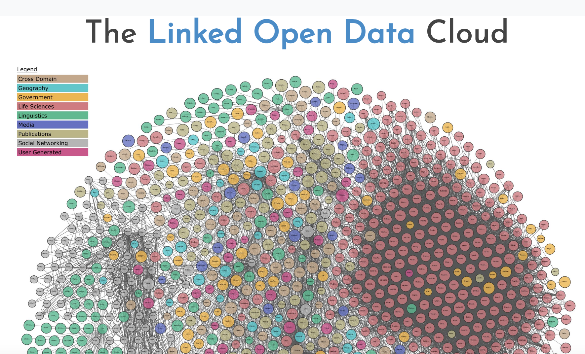

# Outline

1. What and why: linked data and controlled vocabularies
2. LCSH (Library of Congress Subject Headings)
3. Personal name authority files (VIAF)
4. Walkthrough and supported work time

## Linked Open Data



View the [interactive LOD cloud here](https://lod-cloud.net/clouds/lod-cloud.svg)

## FAIR Data

- F - Findable: well-described and indexed in searchable resources
- A - Accessible: public in a usable form
- I - Interoperable: uses shared categories and vocabularies
- R - Reusable: process documentation and metadata are accurate

## Interoperability

For a dataset to be interoperable, it has to have points of agreement with other datasets: pre-defined categories that have meaning outside of that dataset's context.

Not only does this help validate the data by using clear and established definitions it also helps users combine data from multiple sources.

## Examples

- Cervantes Virtual: [lod-cloud.net/dataset/BVMC](https://lod-cloud.net/dataset/BVMC)
- Futuristic Fiction: [data.post45.org/posts/futuristic-fiction/](https://data.post45.org/posts/futuristic-fiction/)

# LCSH 

Library of Congress Subject Headings

[Library of Congress Linked Data Service](https://id.loc.gov/)

## Example: publication location

Disambiguate location names that are similar by providing geographic areas and regions

- Search [LC linked data service - geographic](https://id.loc.gov/search/?q=memberOf:http://id.loc.gov/authorities/subjects/collection_GeographicSubdivisions)
- *Revista Ariel* - [*Revista Ariel* on Cervantes Virtual](https://www.cervantesvirtual.com/obra/revista-ariel-923925/)
- Tegucigalpa: Alcaldía Mayor vs. Francisco Morazán

## Example: type of publication

- [LCSH - GenreForm](https://id.loc.gov/search/?q=memberOf:http://id.loc.gov/authorities/subjects/collection_GenreFormSubdivisions)
- Periodical -> "Forma/género: Publicación periódica"

# Named Authorities

[VIAF: The Virtual International Authority File](https://viaf.org/en)

[Wikidata](https://www.wikidata.org/)

## VIAF
- International consortium of libraries and professional organizations: [see contributors](https://viaf.org/en)
  - NB: the US flag symbolizes [Library of Congress/NACO](https://viaf.org/en/contributors?id=LC)
- Makes it easier for librarians to catalog new materials by standardizing headings so that alternate forms can be cross-referenced

## Example: author names

- Oscar Wilde
- Search 'Personal Names'
- VIAF: [viaf.org/en/viaf/34464414](https://viaf.org/en/viaf/34464414)
- Use the form with the US flag/the most flags: 'Wilde, Oscar, 1854-1900'
- Scroll down for biographical details (gender, nationality, etc.)

## What if someone isn't in VIAF?

1. Check your spelling!
2. Search Wikidata: [wikidata.org/](https://www.wikidata.org/)
3. Search Google (for fuzzy matches) and Wikipedia (for mentions). Include geography or professions. 
   - If you find a likely match with an alternate name form, try VIAF and Wikidata again.
4. Add them to the 'unknown authors' tab and explain what you did and what you found
   - Optional: sleuthing on Google Books and Google

## Process {background-color="white"}

```{mermaid}
flowchart LR
    Z[Author name] --> A[Search VIAF]
    A --> |No| C[Search Wikidata]
    A --> |Yes| B[Add Authority]
    C --> |Yes|B
    C --> |No|D[Alternate name?]
    D --> |Yes|A
    C --> |No| E
    D --> |No| E[Add to Unknown Authors]

```

## Example: Mercedes Laínes

- Not in VIAF
- Wikidata ID [Q138557563](https://www.wikidata.org/wiki/Q138557563)
- Google search suggested "Mercedes Lainez Blanco" and brought me to this [EcuRed Profile](https://www.ecured.cu/Mercedes_La%C3%ADnez_Blanco)
- Other wikidata entry - [Q106614689](https://www.wikidata.org/wiki/Q106614689)

## Wikidata

*"A collaboratively edited multilingual knowledge graph hosted by the Wikimedia Foundation."* (["Wikidata"](https://en.wikipedia.org/wiki/Wikidata), Wikipedia.org).

Like Wikipedia, it's user generated and controlled: that means we can share back what we have discovered or add references for various statements in existing entries.

# Supported work time

What questions do you have?